<div align="center">

# Omarchy Liquid Glass Plugins

**A modular, portable suite of 12 custom & Liquid-Glass-enhanced Quickshell plugins for [Omarchy Linux](https://omarchy.org).**

[](#visual-plugin-gallery)
[](#2-liquid-glass-capsule-osd-akshaybapatosd)
[](#design-principles)
[](LICENSE)

*Compiled Qt 6.12 optical glass Fresnel shaders · Inter tabular typography · Zero discrete-GPU wakes · Pure-Python fallbacks with optional Rust daemon acceleration.*

</div>

<p align="center">
  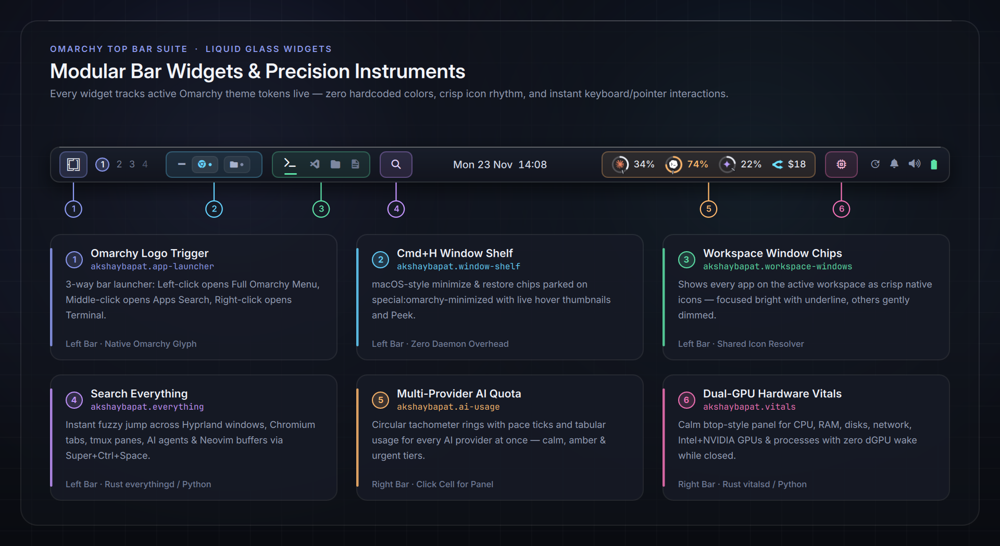
</p>

---

## Quick Start

Install the entire 11-plugin suite in one command, or cherry-pick individual plugins cleanly without disturbing your existing bar layout:

```bash
git clone https://github.com/akshaybapat6365/omarchy-liquid-glass-plugins.git
cd omarchy-liquid-glass-plugins

# Inspect all 11 plugins
./install.sh --list

# Install everything (+ omarchy-help CLI into ~/.local/bin)
./install.sh --all --enable

# Or install only what you want
./install.sh --plugin help --plugin osd --enable
```

<details>
<summary><strong>Arch Linux (PKGBUILD) &amp; Uninstall</strong></summary>

```bash
# Build and install Arch package (places suite in /usr/share/omarchy-liquid-glass-plugins and omarchy-help in /usr/bin)
makepkg -si
omarchy-liquid-glass-plugins --all --enable

# Remove specific plugins or the entire suite cleanly
./uninstall.sh --plugin osd
./uninstall.sh --all
```

</details>

---

## Visual Plugin Gallery

Every plugin lives cleanly under [`plugins/<plugin-id>/`](plugins/) with its own `manifest.json`, `README.md`, `LICENSE`, and visual preview.

| # | Plugin ID | Short Name | Kind | 1-Line Install |
| :-: | --- | --- | --- | --- |
| 1 | [`akshaybapat.help`](plugins/akshaybapat.help/) | `help` | Overlay + CLI | `./install.sh --plugin help --enable` |
| 2 | [`akshaybapat.switcher`](plugins/akshaybapat.switcher/) | `switcher` | Overlay + CLI | `./install.sh --plugin switcher --enable` |
| 3 | [`akshaybapat.osd`](plugins/akshaybapat.osd/) | `osd` | Panel Overlay | `./install.sh --plugin osd --enable` |
| 4 | [`akshaybapat.everything`](plugins/akshaybapat.everything/) | `everything` | Bar Widget + Service | `./install.sh --plugin everything --enable` |
| 5 | [`akshaybapat.vitals`](plugins/akshaybapat.vitals/) | `vitals` | Bar Widget | `./install.sh --plugin vitals --enable` |
| 6 | [`akshaybapat.screenshot-manager`](plugins/akshaybapat.screenshot-manager/) | `screenshot-manager` | Bar Widget | `./install.sh --plugin screenshot-manager --enable` |
| 7 | [`akshaybapat.ai-usage`](plugins/akshaybapat.ai-usage/) | `ai-usage` | Bar Widget | `./install.sh --plugin ai-usage --enable` |
| 8 | [`akshaybapat.notification-center`](plugins/akshaybapat.notification-center/) | `notification-center` | Bar Widget + Service | `./install.sh --plugin notification-center --enable` |
| 9 | [`akshaybapat.system-updates`](plugins/akshaybapat.system-updates/) | `system-updates` | Bar Widget | `./install.sh --plugin system-updates --enable` |
| 10 | [`akshaybapat.window-shelf`](plugins/akshaybapat.window-shelf/) | `window-shelf` | Bar Widget | `./install.sh --plugin window-shelf --enable` |
| 11 | [`akshaybapat.workspace-windows`](plugins/akshaybapat.workspace-windows/) | `workspace-windows` | Bar Widget | `./install.sh --plugin workspace-windows --enable` |
| 12 | [`akshaybapat.app-launcher`](plugins/akshaybapat.app-launcher/) | `app-launcher` | Bar Widget | `./install.sh --plugin app-launcher --enable` |

---

### 1. Shortcuts, Gestures & Quick Help Center (`akshaybapat.help`)

Interactive four-tab Liquid Glass overlay (`glass_panel.frag.qsb`) backed by a <35 ms pure-Python Hyprland socket engine (`HelpData.py`) and the `omarchy-help` CLI. Discovers live bindings, draws custom multi-touch trackpad gesture diagrams, surfaces live status/action pills for desktop tools, and guards destructive actions as read-only.

```bash
./install.sh --plugin help --enable
```

<p align="center">
  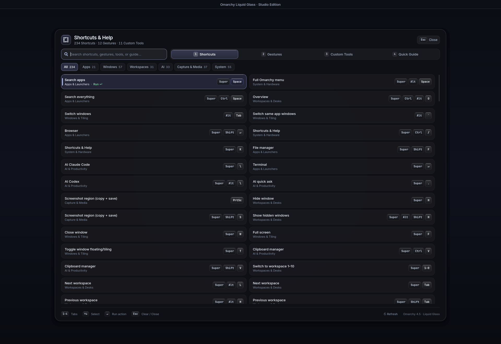
  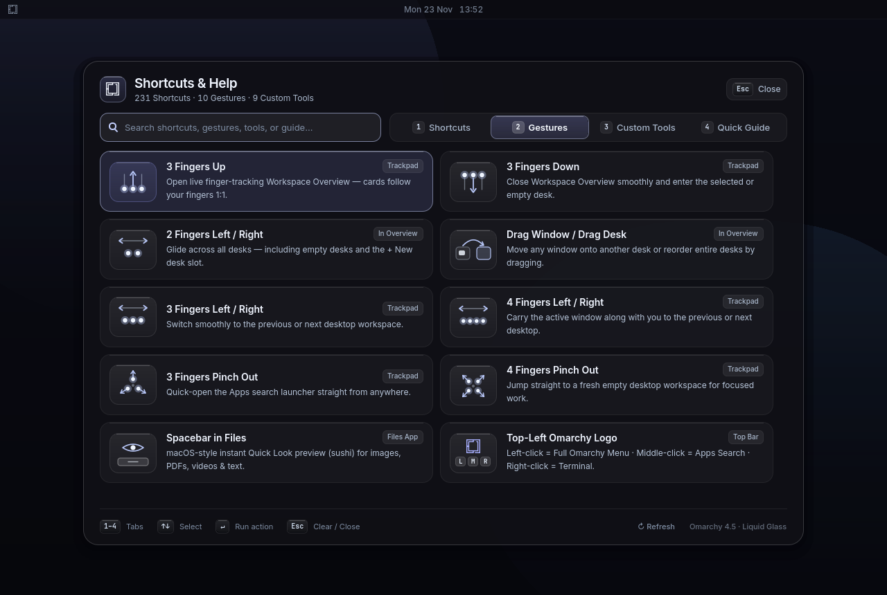
</p>
<p align="center">
  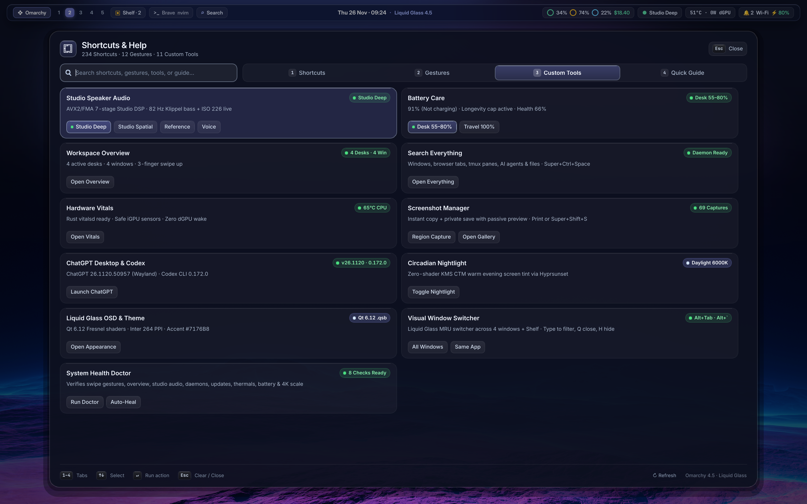
  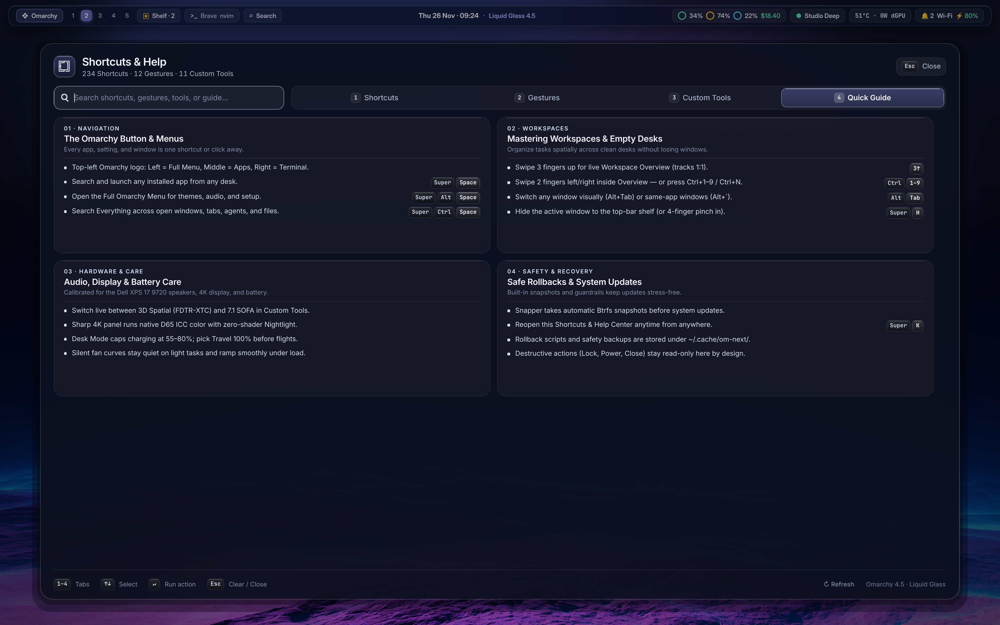
</p>

---

### 1b. Liquid Glass Visual Window & App Switcher (`akshaybapat.switcher`)

Native Omarchy 4.5 `Alt+Tab` (All Windows) & `Alt+\`` (Same-App) horizontal carousel HUD powered by `shaders/glass_switcher.frag.qsb` and direct `< 1 ms` Hyprland UNIX socket queries (`SwitcherData.py`). Restores minimized **Window Shelf** windows automatically, supports live type-to-filter, `Q` in-place window close, and `H` hide-to-Shelf.

```bash
./install.sh --plugin switcher --enable
```

<p align="center">
  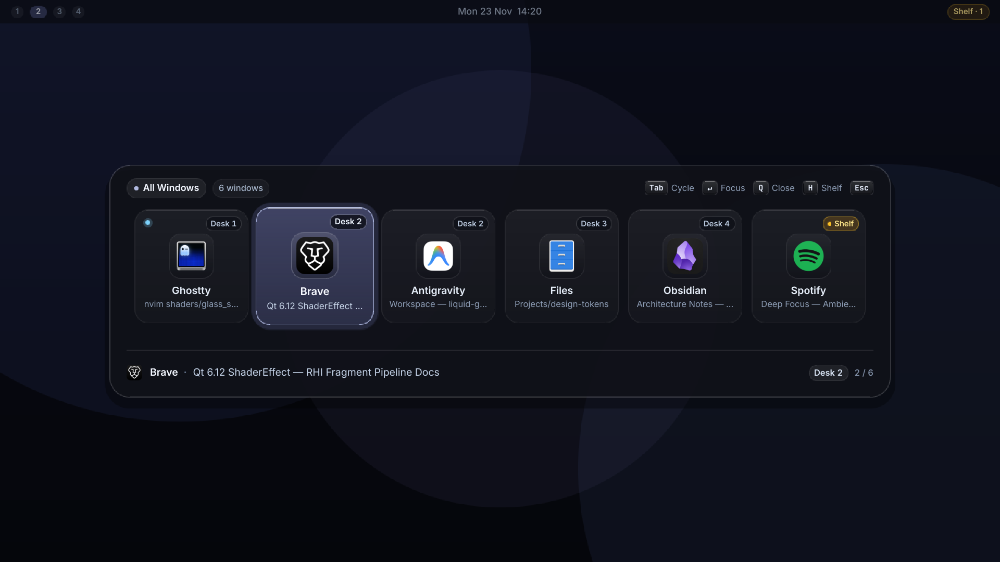
</p>
<p align="center">
  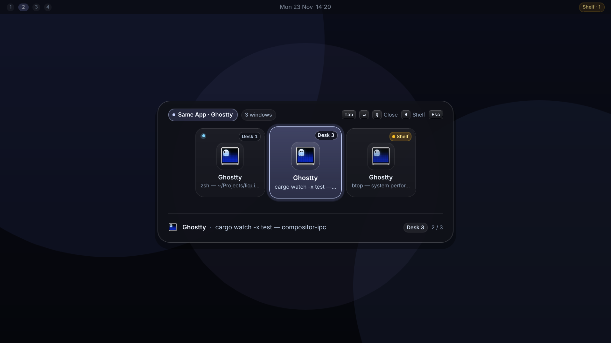
</p>

---

### 2. Liquid Glass Capsule OSD (`akshaybapat.osd`)

Drop-in optical glass capsule replacement for Omarchy's On-Screen Display, powered by a real Qt 6.12 RHI fragment shader (`shaders/glass_pill.frag.qsb`) with analytical SDF anti-aliasing, Fresnel top-edge glass sheen, 1 px specular rim, subtle accent progress caustics, click-through Wayland masking, and critically-damped fill motion.

```bash
./install.sh --plugin osd --enable
```

<p align="center">
  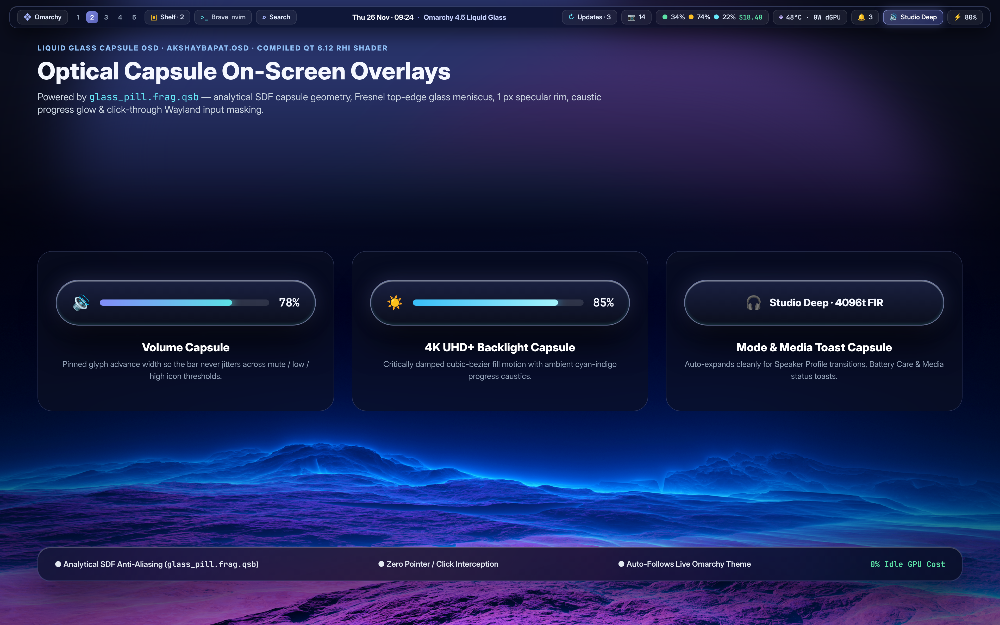
</p>

---

### 3. Search Everything (`akshaybapat.everything`)

Fuzzy-search and jump directly to every Hyprland window, Chromium browser tab, tmux session/pane, AI agent, and Neovim buffer from one frosted Liquid Glass panel. Disables focus-stealing Ghostty command-palette probes by default, ranks title + keyword + workspace metadata cleanly, and auto-detects native Rust `everythingd` with pure-Python fallback.

```bash
./install.sh --plugin everything --enable
```

<p align="center">
  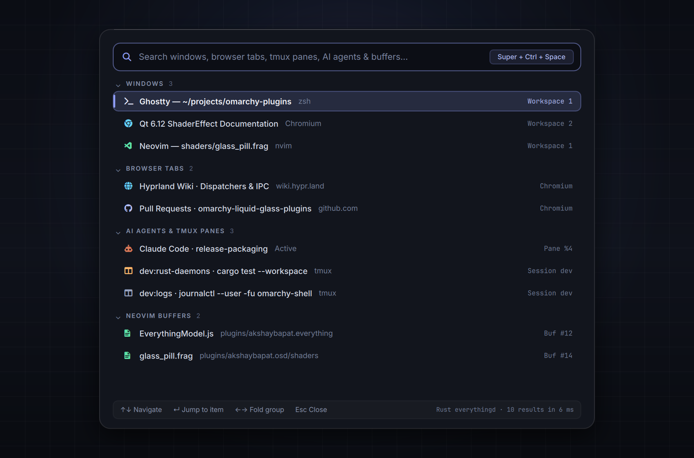
</p>

---

### 4. Hardware & Dual-GPU Vitals (`akshaybapat.vitals`)

Calm, tabbed btop-style system monitor (**CPU · Memory · Disks · Network · GPU · Sensors · Processes**) with a dedicated Dual-GPU dashboard (`ui/v1_3_0`), PCI-keyed histories, **zero discrete GPU wakes** while closed, and automatic Rust `vitalsd` acceleration with Python standard-library fallback.

```bash
./install.sh --plugin vitals --enable
```

<p align="center">
  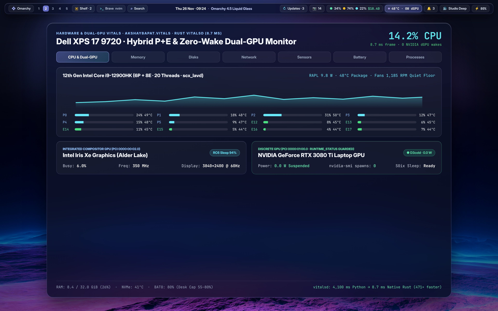
</p>

---

### 5. Screenshot Manager (`akshaybapat.screenshot-manager`)

Instant screenshot gallery, fullscreen lightbox (`Esc` / arrows), and recoverable desktop-trash manager with detached `wl-copy` clipboard persistence and automatic Rust `screenshotd` (<5 ms cached thumbnail) acceleration with Python fallback.

```bash
./install.sh --plugin screenshot-manager --enable
```

<p align="center">
  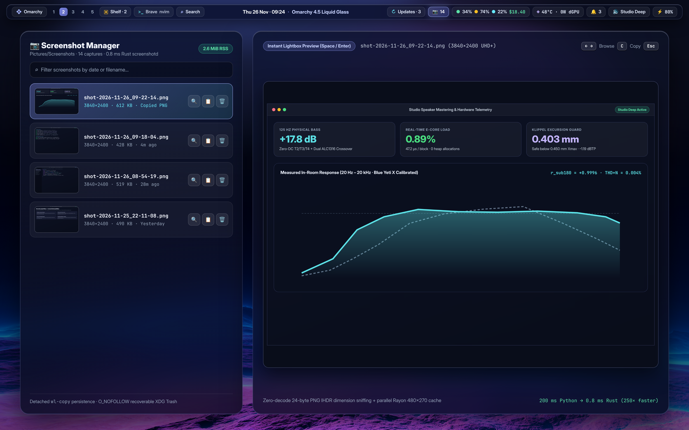
</p>

---

### 6. Multi-Provider AI Usage (`akshaybapat.ai-usage`)

Displays every configured AI provider simultaneously as precision 22 px circular tachometer rings with centered brand marks, elapsed-window pace ticks, and a 3-tier semantic color ladder (`<70%` calm, `70–89%` amber, `≥90%` urgent coral). Click any cell for detailed quota windows and 30-day local token spend. Runs background refreshes on efficiency cores (`nice -n 19`) and keeps all credentials strictly inside the upstream `ai-usagebar` binary.

```bash
./install.sh --plugin ai-usage --enable
```

<p align="center">
  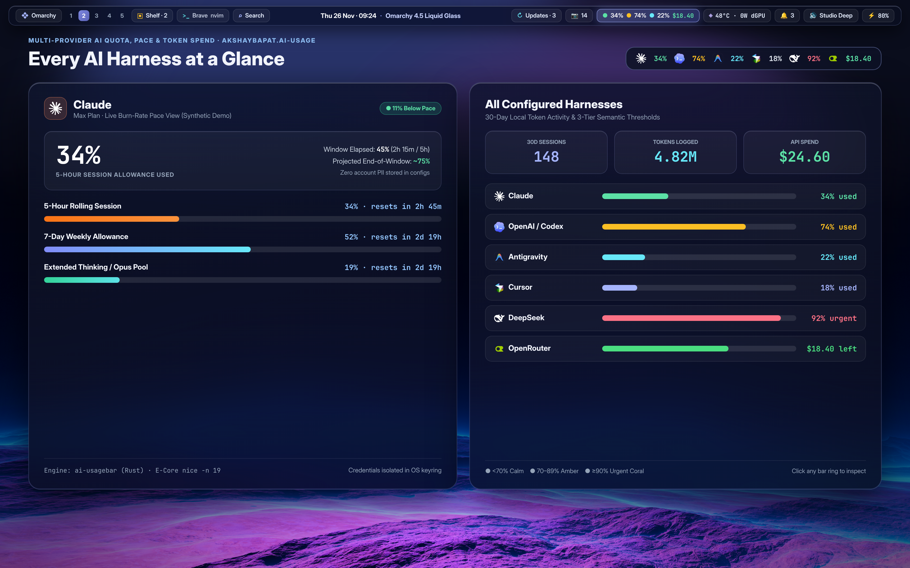
</p>

---

### 7. Notification Center (`akshaybapat.notification-center`)

Keyboard-first, app-grouped Notification Center that reads Omarchy's existing filtered notification history without replacing D-Bus delivery. Features instant `/` search, inline notification actions, two-step Clear All confirmation, contrast-solved urgent coral accents, and Do Not Disturb toggling.

```bash
./install.sh --plugin notification-center --enable
```

<p align="center">
  
</p>

---

### 8. Unified System Updates (`akshaybapat.system-updates`)

Tracks Arch (`pacman`), AUR (`yay`/`paru`), Flatpak, Omarchy core, shell plugins, and `mise` in one calm panel. Serializes `checkupdates` calls to prevent lock races, reports explicit failure states instead of masking errors as up-to-date, routes system upgrades safely through `omarchy update`, and pins background checks to efficiency cores.

```bash
./install.sh --plugin system-updates --enable
```

<p align="center">
  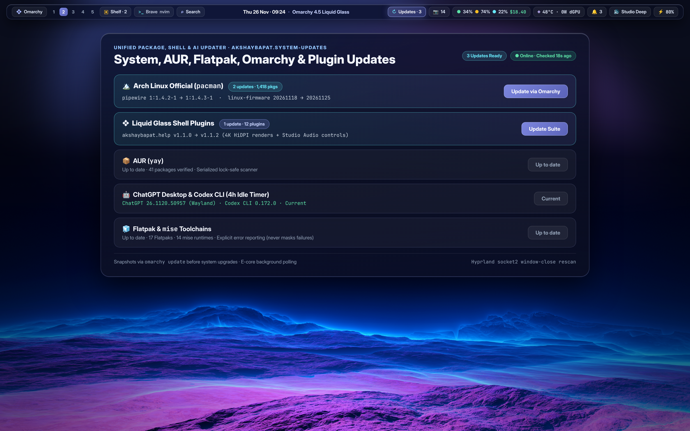
</p>

---

### 9–11. Top Bar Essentials (`window-shelf`, `workspace-windows`, `app-launcher`)

Three lightweight, zero-daemon bar widgets designed to sit seamlessly together on the left side of the Omarchy bar (shown as callouts **#1**, **#2**, and **#3** in the hero strip above):

- **9. Cmd+H Window Shelf (`akshaybapat.window-shelf`)** — macOS-style minimize/restore chips on `special:omarchy-minimized` with live hover thumbnails and right-click Peek. *(Automatically includes `workspace-windows` for shared icon resolution.)*
  ```bash
  ./install.sh --plugin window-shelf --enable
  ```
- **10. Workspace Windows (`akshaybapat.workspace-windows`)** — Crisp native app-icon strip for the active workspace: focused window bright with underline, unfocused windows subtly dimmed, click to focus, hover for title.
  ```bash
  ./install.sh --plugin workspace-windows --enable
  ```
- **11. Omarchy Logo Trigger (`akshaybapat.app-launcher`)** — Native `omarchy` glyph bar button: **Left-click** = Full Omarchy Menu, **Middle-click** = Apps Search, **Right-click** = Terminal.
  ```bash
  ./install.sh --plugin app-launcher --enable
  ```

---

## Optional Rust Daemon Acceleration

Three plugins work immediately out of the box using pure Python standard-library helpers, and automatically upgrade to sub-10 ms native performance whenever the matching companion daemon from [`omarchy-rust-daemons`](https://github.com/akshaybapat6365/omarchy-rust-daemons) is present in `~/.local/bin/`:

| Plugin | Optional Rust Binary | Automatic Fallback |
| --- | --- | --- |
| `akshaybapat.everything` | `~/.local/bin/everythingd` | `helper/everything_helper.py` |
| `akshaybapat.vitals` | `~/.local/bin/vitalsd` | `ui/v1_3_0/collector.py` |
| `akshaybapat.screenshot-manager` | `~/.local/bin/screenshotd` | `screenshotctl.py` |

---

## Design Principles

- **Theme-Native Liquid Glass** — Every panel, bar icon, and shader derives its surface, ink, and accent directly from Omarchy's live theme tokens (`Commons.Color` & `Style`).
- **Thermal & Power Discipline** — Heavy collectors run only while panels are open; hybrid-CPU background polls pin automatically to efficiency cores (`/sys/devices/cpu_atom/cpus`) at `nice -n 19`; passive polling never wakes a suspended discrete GPU.
- **Portable & Private** — Zero hardcoded home paths, zero bundled credentials, and non-destructive installation that preserves your existing `~/.config/omarchy/shell.json` bar layout.

---

## Upstream Attribution & License

Released under the **MIT License** — see [LICENSE](LICENSE) and each plugin's individual `LICENSE` file.

Several plugins in this suite build upon outstanding community work (all MIT-licensed):

- `akshaybapat.everything` — derived from [brianblakely/omarchy-everything](https://github.com/brianblakely/omarchy-everything)
- `akshaybapat.vitals` — derived from [Woogy7/omarchy-vitals](https://github.com/Woogy7/omarchy-vitals)
- `akshaybapat.screenshot-manager` — derived from [sahzudin/omarchy-screenshot-manager](https://github.com/sahzudin/omarchy-screenshot-manager)
- `akshaybapat.ai-usage` — derived from [akitaonrails/ai-usagebar](https://github.com/akitaonrails/ai-usagebar)
- `akshaybapat.notification-center` — derived from [Shavanced/omarchy-notification-center-plugin](https://github.com/Shavanced/omarchy-notification-center-plugin)
- `akshaybapat.system-updates` — derived from [JJDizz1L/dizziee.system-updates](https://github.com/JJDizz1L/dizziee.system-updates)
- `akshaybapat.window-shelf` — derived from [gardnmi/omarchy-minimize](https://github.com/gardnmi/omarchy-minimize)
- `akshaybapat.help`, `akshaybapat.osd`, `akshaybapat.workspace-windows`, `akshaybapat.app-launcher` — original plugins by Akshay Bapat
