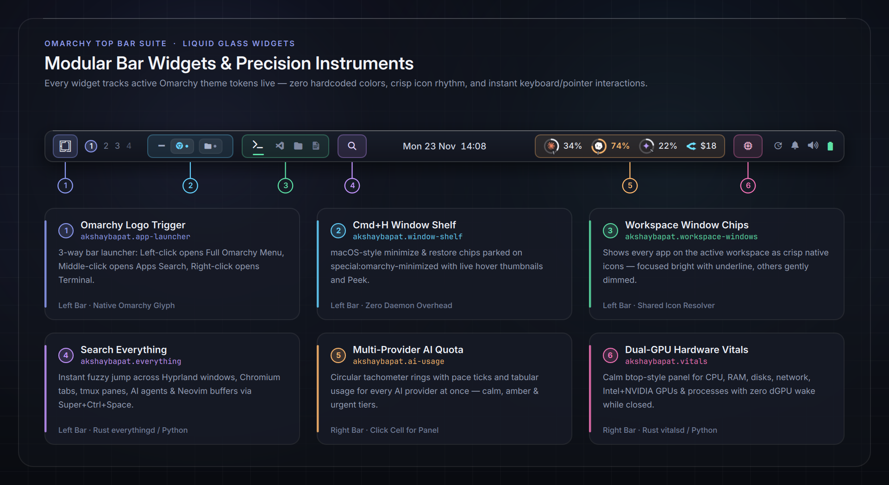

# Omarchy Logo Trigger (`akshaybapat.app-launcher`)

Ultra-clean 3-way top-bar launcher button using the native `omarchy` logo glyph (`\ue900`):

- **Left-click** — Open the Full Omarchy Menu (`omarchy-menu toggle root`)
- **Middle-click** — Open Apps Search (`omarchy-menu toggle apps`)
- **Right-click** — Launch your default terminal (`xdg-terminal-exec`)

<p align="center">
  
</p>

## Install

```bash
../../install.sh --plugin app-launcher --enable
```

Zero background processes, zero settings needed, tracks active bar foreground and spacing tokens natively.

## License

MIT — see [LICENSE](LICENSE). Copyright (c) 2026 Akshay Bapat.
