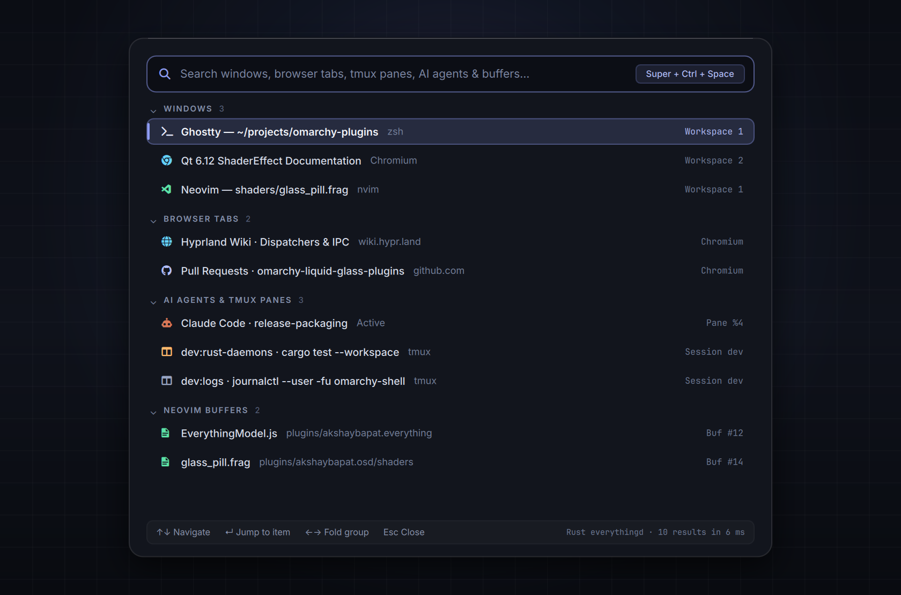

# Search Everything (`akshaybapat.everything`)

List, fuzzy-search, and jump directly to every Hyprland window, Chromium browser tab, tmux session/window/pane, AI agent, and Neovim buffer — all from one frosted Liquid Glass command panel.

Derived from [brianblakely/omarchy-everything](https://github.com/brianblakely/omarchy-everything) (MIT) with Liquid Glass typography, safer non-stealing Ghostty discovery, richer metadata search, and optional sub-10 ms Rust daemon acceleration (`everythingd`).

<p align="center">
  
</p>

## What Changed in This Fork

- **No Focus-Stealing Ghostty Palette Probes** — Upstream opens Ghostty's command palette on every panel open; this fork disables palette probing by default (while keeping Ghostty windows discovered via Hyprland) unless `ghosttyPalette` is explicitly enabled in `Service.qml`.
- **Keyword & Context Search** — Matches app class, workspace, directory, and context subtitle alongside titles (with title matches still ranking first).
- **Non-Overlapping Rescan Poll** — Waits for the previous scan to finish before scheduling the next refresh (6 s cadence) so the helper stays calm.
- **Rust `everythingd` with Python Fallback** — Automatically uses `$HOME/.local/bin/everythingd` when installed and falls back transparently to pure-Python `helper/everything_helper.py`.

## Install

```bash
../../install.sh --plugin everything --enable
```

Recommended `~/.config/hypr/bindings.lua` binding:

```lua
o.bind("SUPER + CTRL + SPACE", "Search Everything", "omarchy-shell shell toggle akshaybapat.everything")
```

## Keyboard Controls

| Keys | Action |
| --- | --- |
| `↑` / `↓` or `k` / `j` | Move selection |
| `←` / `→` or `h` / `l` | Collapse / expand current group |
| `Enter` / `Space` | Jump directly to the selected window, tab, pane, or buffer |
| `/` | Focus search field |
| `x` / `Del` | Temporarily hide highlighted result until restart |
| `Esc` | Clear search or close panel |

Right-click the bar trigger to choose which provider groups appear in results. See [docs/architecture.md](docs/architecture.md) and [docs/security.md](docs/security.md) for protocol and trust-boundary details.

## License

MIT — see [LICENSE](LICENSE). Copyright Brian Blakely (original) and Akshay Bapat (fork).
