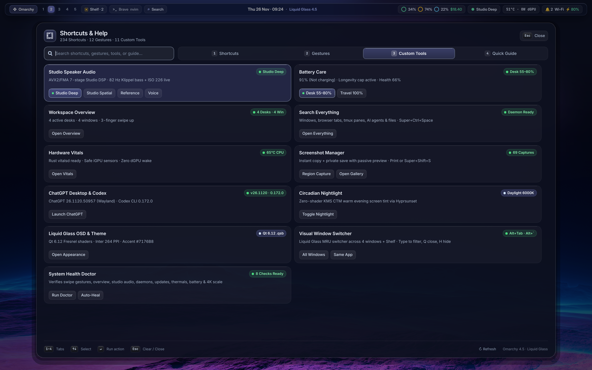
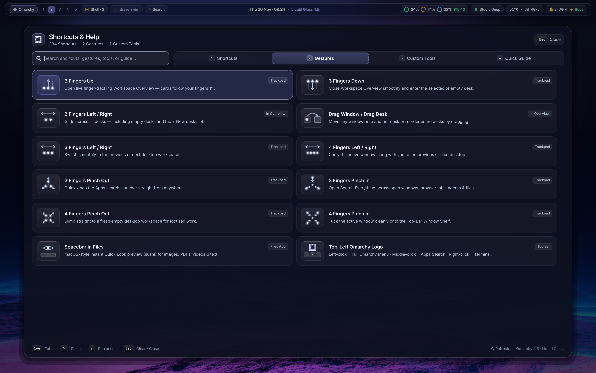
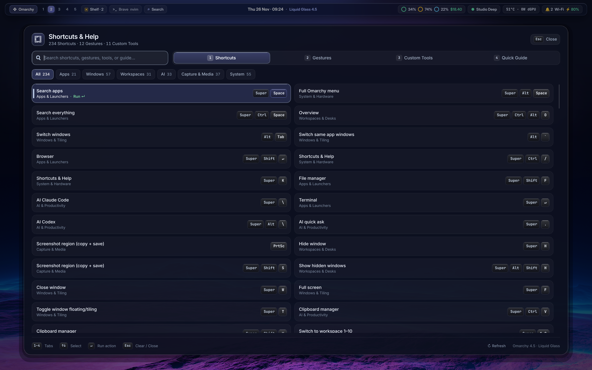
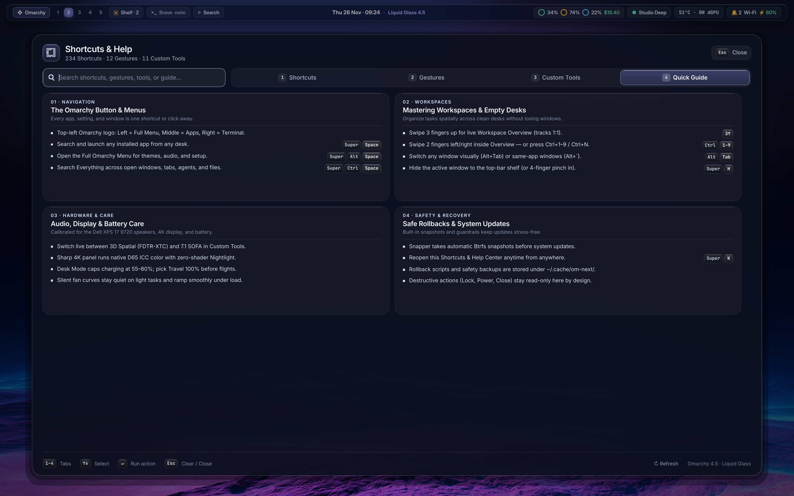

# Shortcuts & Help (`akshaybapat.help`)

A Liquid Glass interactive **Shortcuts, Trackpad Gestures, Custom Tools & Quick Help Center** overlay for the [Omarchy](https://omarchy.org) shell, powered by a compiled Qt 6.12 optical glass fragment shader (`shaders/glass_panel.frag.qsb`) and a fast pure-Python standard-library live data engine (`HelpData.py`, <35 ms wall time, zero dGPU wakes).

<p align="center">
  <a href="preview-tools.png"></a>
</p>
<p align="center">
  <a href="preview-gestures.png"></a>
</p>
<p align="center">
  <a href="preview.png"></a>
</p>
<p align="center">
  <a href="preview-guide.png"></a>
</p>

## Highlights

- **Live Hyprland Binding Discovery** — Reads active bindings directly over the Hyprland UNIX socket (`j/binds`) plus user `bindings.lua`, grouped cleanly into Apps, Windows, Workspaces, AI, Capture & Media, and System.
- **Interactive Execution with Guardrails** — Press `Enter` on any safe shortcut or Custom Tool button to run it immediately; destructive power/lock/close actions remain read-only by design.
- **Custom Trackpad Gesture Glyphs** — Vector-rendered 2-, 3-, and 4-finger swipe & pinch diagrams in `GestureGlyph.qml`.
- **Live Tool Telemetry** — Displays live status for 3D Spatial Audio, Battery Care, Workspace Overview, Search Everything, Hardware Vitals, Screenshot Manager, Circadian Nightlight, and Liquid Glass theme shaders.
- **Bundled CLI (`omarchy-help`)** — Installed to `~/.local/bin/omarchy-help` for instant keybinding and scripting.

## Install

```bash
../../install.sh --plugin help --enable
```

## Usage & Keybindings

```bash
omarchy-help toggle      # Toggle overlay (default)
omarchy-help shortcuts   # Jump directly to Shortcuts tab
omarchy-help gestures    # Jump directly to Trackpad Gestures tab
omarchy-help tools       # Jump directly to Custom Tools tab
omarchy-help guide       # Jump directly to Quick Guide tab
omarchy-help refresh     # Refresh live bindings and telemetry
```

Recommended `~/.config/hypr/bindings.lua` binding:

```lua
o.bind("SUPER + K", "Shortcuts & Help", "omarchy-help toggle")
```

Inside the overlay: `1`–`4` switch tabs, `↑`/`↓` select items, `Enter` runs safe actions, `Esc` clears search or closes.

## License

MIT — see [LICENSE](LICENSE).
