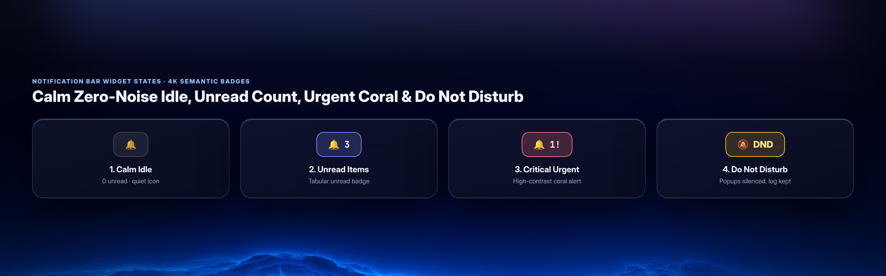

# Notification Center (`akshaybapat.notification-center`)

A keyboard-first, app-grouped Notification Center for [Omarchy](https://omarchy.org) that reads Omarchy's existing filtered notification history without replacing the notification daemon.

Derived from [Shavanced/omarchy-notification-center-plugin](https://github.com/Shavanced/omarchy-notification-center-plugin) (MIT) with a complete 2.0 Liquid Glass architecture, contrast-solved alarm inks, search filtering, two-step Clear All confirmation, and live DND state.

<p align="center">
  <a href="preview.png"></a>
</p>
<p align="center">
  <a href="screenshots/bar-states.png"></a>
</p>

## Highlights

- **Non-Invasive Architecture** — Reads Omarchy's native notification service cleanly without taking over D-Bus delivery.
- **App-Grouped Cards & Actions** — Groups notifications by application with unread badges, urgent coral highlights (`AlarmInk.js`), inline action buttons, and source-owned thumbnail previews.
- **Keyboard-First Workflow** — Arrow/Vim navigation, `/` instant search across sender/title/body, two-step `Clear all` confirmation, and one-click Do Not Disturb toggle.
- **Persistent Read State** — Stores read cursor cleanly in `${XDG_STATE_HOME:-~/.local/state}/akshaybapat.notification-center/state.json`.

## Install

```bash
../../install.sh --plugin notification-center --enable
```

## Shell IPC

```bash
omarchy-shell akshaybapat.notification-center toggle
omarchy-shell akshaybapat.notification-center open
omarchy-shell akshaybapat.notification-center close
omarchy-shell akshaybapat.notification-center unread
omarchy-shell akshaybapat.notification-center markAllRead
omarchy-shell akshaybapat.notification-center clear
omarchy-shell akshaybapat.notification-center toggleDnd
```

## License

MIT — see [LICENSE](LICENSE). Copyright Shavanced (original) and Akshay Bapat (2.0 architecture).
