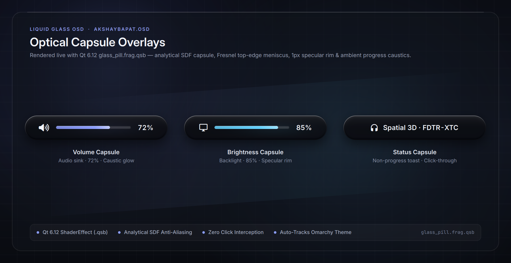

# Liquid Glass OSD (`akshaybapat.osd`)

Sculpted optical Liquid Glass capsule On-Screen Display for [Omarchy](https://omarchy.org), rendered with a compiled Qt 6.12 RHI fragment shader (`shaders/glass_pill.frag.qsb`), Inter tabular typography, and critically-damped progress bar animations.

<p align="center">
  
</p>

## Highlights

- **Compiled Qt 6.12 Optical Shader (`glass_pill.frag.qsb`)** — Analytical SDF anti-aliased capsule with smoked obsidian tint, top-edge Fresnel glass meniscus, 1 px specular bezel, and subtle ambient progress caustics.
- **Zero Click Interception** — Empty Wayland input mask (`mask: Region {}`) so clicks pass straight through the floating capsule.
- **Zero Layout Jitter** — Nerd Font icon column is pinned to the widest progress glyph and numerals use OpenType tabular figures (`tnum`).
- **Auto-Tracks Omarchy Themes** — Reads active `Color.background` and `Color.accent`, lifting pure `#000000` subtly to smoked obsidian so glass depth survives on pitch-black wallpapers.
- **Graceful Software Fallback** — Automatically falls back to a rounded translucent capsule if shaders are unavailable.

## Install

```bash
../../install.sh --plugin osd --enable
```

## Shell IPC

Compatible drop-in replacement for the built-in `osd` target:

```bash
omarchy-shell osd show '{"icon":"volume-high","value":72,"max":100}'
omarchy-shell osd show '{"icon":"brightness","value":85,"max":100}'
omarchy-shell osd show '{"icon":"󰋋","message":"Spatial 3D · FDTR-XTC","duration":1800}'
omarchy-shell osd close
```

## License

MIT — see [LICENSE](LICENSE).
