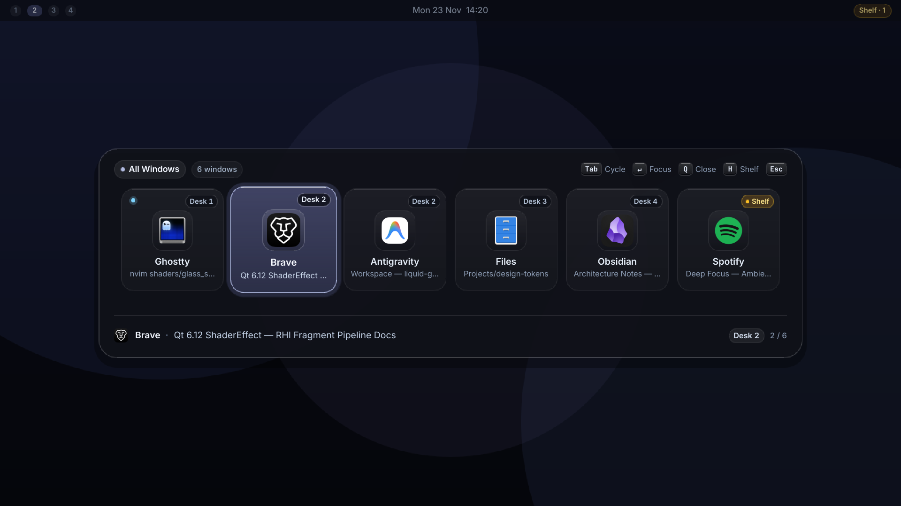
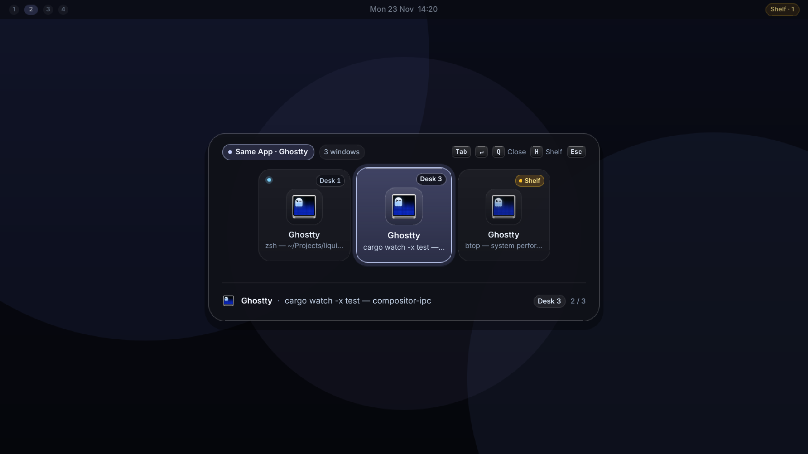

# Liquid Glass Window & App Switcher (`akshaybapat.switcher`)

Native **Omarchy 4.5** visual MRU window and same-app switcher overlay powered by a compiled **Qt 6.12 `.qsb`** smoked-obsidian optical glass shader (`shaders/glass_switcher.frag.qsb`) and a direct `< 1 ms` Hyprland UNIX socket engine (`SwitcherData.py`).

<p align="center">
  
</p>

<p align="center">
  
</p>

## Highlights

- **All-Windows (`Alt+Tab`) & Same-App (`Alt+\``) Modes** — True MRU `focusHistoryID` ordering across all workspaces plus minimized **Window Shelf** (`special:omarchy-minimized`) windows (rendered with a luminous amber `Shelf` badge and restored automatically on selection).
- **Qt 6.12 Optical Glass Shader** — Smoked obsidian glass capsule (`#101219` @ `0.86`), 45° overhead Fresnel meniscus, 1 px specular rim, and dynamic ambient caustic tracking the selected card's horizontal coordinate (`focusX`).
- **Keyboard-First Power Actions** — Hold `Alt` + tap `Tab`/`\`` and release `Alt` to switch immediately, type letters to filter live, press `Q`/`Delete` to close a window in-place, or press `H` to tuck it onto the Top-Bar Window Shelf.

## Quick Install

```bash
./install.sh --plugin switcher --enable
```

Add to `~/.config/hypr/bindings.lua`:

```lua
replace("ALT + TAB", "Switch windows", "omarchy-switcher next")
replace("ALT + SHIFT + TAB", "Switch windows (previous)", "omarchy-switcher prev")
replace("ALT + grave", "Switch same app windows", "omarchy-switcher same-app")
replace("ALT + SHIFT + grave", "Switch same app windows (previous)", "omarchy-switcher same-app-prev")
```

## License

[MIT](LICENSE)
