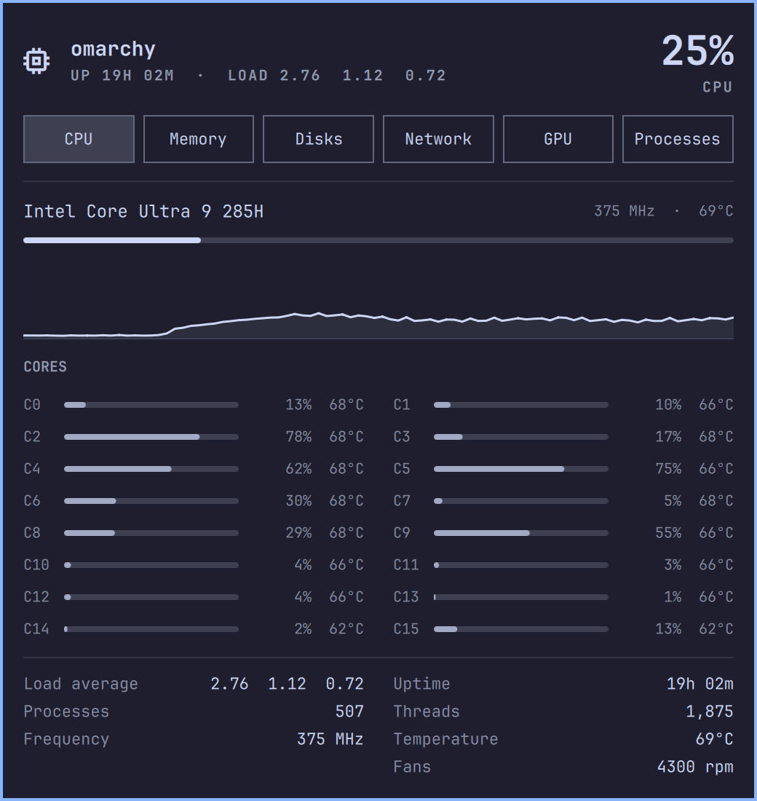
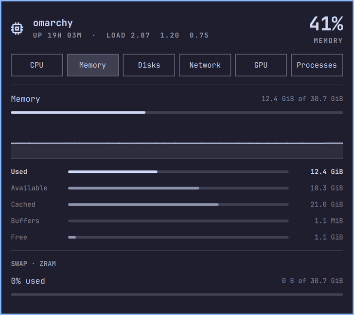
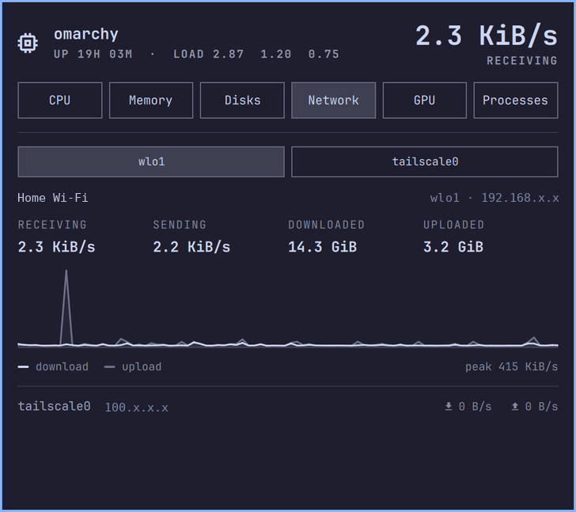
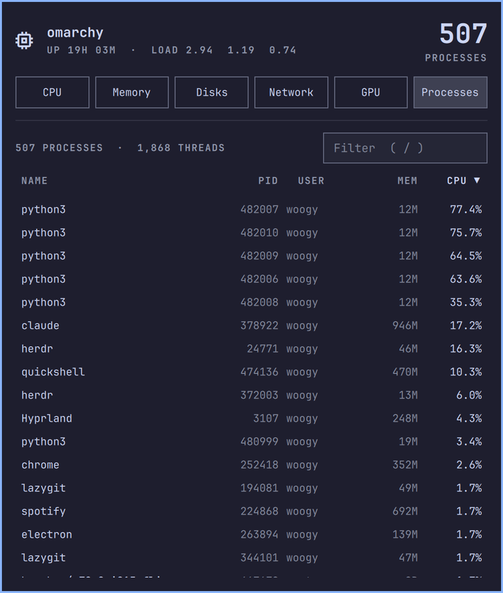

# Hardware & Dual-GPU Vitals (`akshaybapat.vitals`)

A calm, tabbed btop-style system and dual-GPU monitor for the [Omarchy](https://omarchy.org) shell covering **CPU · Memory · Disks · Network · GPU · Sensors · Processes** — engineered for **zero discrete GPU wakes** while closed, with optional native Rust `vitalsd` acceleration and automatic Python standard-library fallback.

Derived from [Woogy7/omarchy-vitals](https://github.com/Woogy7/omarchy-vitals) (MIT) with an expanded Dual-GPU dashboard (`ui/v1_3_0`), independent PCI-keyed GPU histories, and Rust daemon support.

<p align="center"></p>
<p align="center">
  
  
  
</p>

## Highlights

- **Zero dGPU Wakes & Zero Idle Cost** — Telemetry collection runs *only* while the panel is open; passive bar rendering never wakes a suspended NVIDIA GPU.
- **Dual-GPU Dashboard (`ui/v1_3_0`)** — Separate device cards and synchronized 220 px history plots for discrete NVIDIA and integrated Intel/AMD GPUs, distinguishing shared die temperature from discrete probes.
- **Rust `vitalsd` + Pure-Python Fallback** — Automatically uses `$HOME/.local/bin/vitalsd` (<10 ms snapshots) when installed, falling back seamlessly to `ui/v1_3_0/collector.py` (Python stdlib only, no root required).
- **Keyboard-First Navigation** — `1`–`7` or `h`/`l` switch tabs, `/` filters processes, `s`/`r` sort columns, `Enter` expands full command line, `x` terminates with confirmation.

## Install

```bash
../../install.sh --plugin vitals --enable
```

## IPC & Keybindings

```bash
omarchy-shell akshaybapat.vitals toggle
omarchy-shell akshaybapat.vitals showTab gpu   # cpu | mem | disk | net | gpu | sensors | proc
```

## Settings

| Key | Default | Description |
| --- | --- | --- |
| `refreshSeconds` | `2` | Sampling interval in seconds (`1`–`10`) while panel is open |

## License

MIT — see [LICENSE](LICENSE). Copyright Woogy7 (original) and Akshay Bapat (fork).
