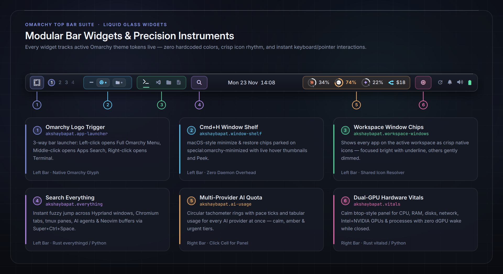

# Cmd+H Window Shelf (`akshaybapat.window-shelf`)

macOS-style `Cmd+H` minimized window shelf for Hyprland and [Omarchy](https://omarchy.org) — one bar button toggles minimize/restore, while each hidden window appears as an app-icon chip with live hover preview and right-click interactive Peek.

Derived from [gardnmi/omarchy-minimize](https://github.com/gardnmi/omarchy-minimize) (MIT) with shared native desktop-entry icon resolution (`WindowIcons.js`), icon-only minimal chips by default, and theme-native bar typography.

<p align="center">
  
</p>

## Highlights

- **Smart Minimize / Restore Toggle** — Minimizes the focused window onto `special:omarchy-minimized`, or restores the most recently hidden window when the workspace is empty.
- **Live Hover Preview & Right-Click Peek** — Hover a chip for a live window thumbnail (`PreviewSurface.qml`); right-click to temporarily stage the window on `special:omarchy-window-peek`.
- **Zero Background Daemon** — Reads minimized window state straight from Hyprland IPC so hidden windows survive shell restarts.
- **Companion Dependency** — Imports `WindowIcons.js` from `akshaybapat.workspace-windows`; `./install.sh --plugin window-shelf` installs both automatically.

## Install

```bash
../../install.sh --plugin window-shelf --enable
```

Recommended `~/.config/hypr/bindings.lua` binding (macOS `Cmd+H` feel):

```lua
o.bind("SUPER + H", "Hide window to shelf", "omarchy-shell akshaybapat.window-shelf toggle")
```

## Settings

| Key | Default | Description |
| --- | --- | --- |
| `showTitles` | `false` | Off: clean app-icon chips (title on hover). On: icon + shortened title |

## Recovery Note

If you ever remove the widget while windows are still parked on the shelf, bring them back immediately with:

```bash
hyprctl dispatch togglespecialworkspace omarchy-minimized
```

## License

MIT — see [LICENSE](LICENSE). Copyright Mike Gardner (original) and Akshay Bapat (fork).
