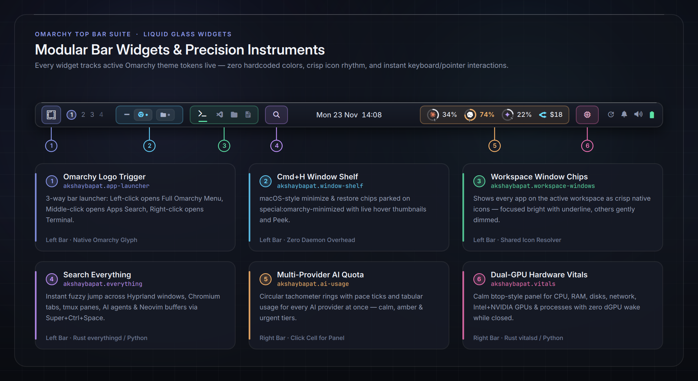

# Workspace Windows (`akshaybapat.workspace-windows`)

Displays every window on the active Hyprland workspace as crisp native application icons right in the [Omarchy](https://omarchy.org) top bar — focused window bright with a clean underline, unfocused windows subtly dimmed, click to focus, hover for title, zero text clutter.

<p align="center">
  
</p>

## Highlights

- **Pure Visual Focus Strip** — Replaces noisy window-title text bars with an iconic, scannable row of real app icons.
- **Accurate Desktop-Entry Icon Resolver (`WindowIcons.js`)** — Matches exact desktop IDs, `StartupWMClass`, and Chromium/Brave web-app launchers using Omarchy's live app-library index (never guesses from window titles), shared cleanly with `akshaybapat.window-shelf`.
- **Theme-Native Contrast** — Tracks Omarchy's active foreground and accent tokens automatically on light and dark themes.

## Install

```bash
../../install.sh --plugin workspace-windows --enable
```

## Settings

| Key | Default | Description |
| --- | --- | --- |
| `maxItems` | `10` | Maximum number of window icons shown (`1`–`20`) |

## License

MIT — see [LICENSE](LICENSE). Copyright (c) 2026 Akshay Bapat.
